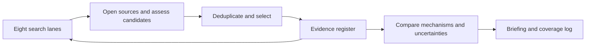

# Regional horizon scanning

A practical way to follow how AI is changing economies across countries, keep the evidence organised, and ask better questions about what might happen next.

This kit recreates the method used by an AI × Economy scan covering **Ukraine, Kazakhstan, Uzbekistan, Armenia, Türkiye and Moldova**, alongside a **regional lane** and a **global research lane**. It is an independently prepared workflow kit, not an official institutional product.

## How it works, in simple terms

1. **Look in eight places every day.** Search each country's relevant languages, then search cross-border developments and new research.
2. **Find what actually changed.** Open the source. Separate the date of the article from the date of the event or data. An announcement tells you what someone intends to do; it does not show results.
3. **Keep a small, useful selection.** Compare candidates for relevance, novelty, economic significance, distributional implications and evidence. Keep up to three per lane. Some lanes may have none.
4. **Explain why it could matter.** Record the observation first, then the economic mechanism, alternative explanations and possible futures. State who might benefit or bear costs, without inventing effects.
5. **Remember and compare.** Save one record for each underlying development. Link updates to earlier records. Over time, compare countries and test emerging interpretations against contradictory evidence.
6. **Report honestly.** Produce a briefing with source links and a coverage log. “We searched and found nothing qualifying” and “we could not complete the search” are different results.



The regional lane needs an explicit cross-border or multi-country pathway. A finding in one country does not become a regional trend simply because it appears in a regional newsletter. Global research needs a transfer test: which local sectors or tasks does it concern, what conditions differ, and what local evidence would establish relevance?

## What runs automatically?

In the original setup, a scheduled AI research agent uses web search, reads a Google Sheets register, writes selected records and prepares an email. The prompt guides its judgment. Search, translation, scoring and interpretation still depend on the agent and the sources it can access. Human review remains a separate step.

This repository provides the **instructions, configuration, data structures and local checking tools** to recreate that workflow. It does not contain a search engine, an LLM API client, Google credentials, an email sender or a scheduler. The local Python commands work offline; live research requires a web-enabled assistant or a researcher. The same evidence rules apply to both.

## Start here

### Use an AI assistant or do the scan manually

1. Download or clone this repository.
2. Read [the method](docs/method.md) and edit [the regional configuration](config/region.json) if your countries or topic differ.
3. Use the ready-to-paste [daily scan prompt](prompts/daily-scan.md). Give your assistant access to web search and a **new, empty** evidence register. Start with one supervised run.
4. Use the field definitions in [schemas/registers.json](schemas/registers.json), or generate blank CSV headers with the command below. They are templates for your own archive, not copies of the originating workspace.
5. Check the saved sources, dates, interpretation and all eight coverage rows before sharing the briefing. Follow [the setup guide](docs/recreate.md) for Google Sheets and recurring runs.

### Try the offline example

Requires **Python 3.11 or newer**. No packages, keys, network calls or paid services are needed for these commands. Run them from this repository's folder:

```sh
python scanner.py demo --out work/demo
python scanner.py validate work/demo/run.json
python scanner.py archive work/demo/run.json --archive work/archive
python scanner.py archive work/demo/run.json --archive work/archive
python -m unittest discover -s tests -v
```

Open `work/demo/briefing.md` and `work/demo/registers/`. All example observations are **fictional** and use `example.org`; they demonstrate the structure, not real findings. The second archive command reports an unchanged run rather than appending duplicates.

For a real run:

```sh
python scanner.py init --out work/my-scan
python scanner.py prompt --date 2026-11-13 --out work/my-scan/daily-prompt.md
```

The `prompt` command combines the daily instructions with your region's configuration and the chosen local date. `init` creates blank register CSVs and an empty run scaffold. Fill the scaffold after researching, then run `validate` and `archive`. Use `python scanner.py brief work/my-scan/run.json --out work/my-scan/briefing.md` to render a digest for review. See [the data guide](docs/data.md).

## What is included

| File | Use |
| --- | --- |
| [docs/method.md](docs/method.md) | Windows, scoring, economic mechanisms and regional interpretation |
| [docs/recreate.md](docs/recreate.md) | First run, Google Sheets, scheduling and optional email |
| [docs/data.md](docs/data.md) | Field structure, local tool commands and validation limits |
| [prompts/daily-scan.md](prompts/daily-scan.md) | Daily research instructions |
| [prompts/review.md](prompts/review.md) | Weekly comparison and monthly interpretation review |
| [config/region.json](config/region.json) | Eight lanes, languages, query seeds and source families |
| [schemas/registers.json](schemas/registers.json) | Signal, research-product, synthesis and coverage fields |
| [docs/origin-and-boundaries.md](docs/origin-and-boundaries.md) | What was inspected and what this adaptation changes |
| [docs/policy-brief-method.md](docs/policy-brief-method.md) | Turn accumulated signals into a short, argument-led policy brief |
| [prompts/policy-brief.md](prompts/policy-brief.md) | Reusable drafting and reasoning instructions |
| [templates/policy-brief.md](templates/policy-brief.md) | Working structure for a one-page brief |
| [examples/policy-brief.md](examples/policy-brief.md) | Fictional example showing how a weak summary becomes a supported argument |

## From scanning to a policy brief

Start with a bounded evidence period and a clear reader question. Compare the mechanisms across cases, choose three or four distinct arguments, and ask what would have to happen for each proposed effect to follow. Then audit each sentence: does it supply evidence, explain the mechanism or clarify the stakes? Keep the prose connected and support each section with one to three compact source links. Approve the wording before designing the page. [Follow the full method](docs/policy-brief-method.md).

No live records, private framing documents, internal workbook links, recipient details or credentials are included. Generated working data stays in the ignored `work/` directory. Review any material you choose to publish separately. The original automations and registers are unaffected.

## Reuse

Code and newly authored documentation are available under the [MIT licence](LICENSE). Third-party articles and reports retain their own rights: keep links and short factual summaries rather than republishing source documents. Contributions should use fictional examples and include tests for changes to validation or archive behaviour.
